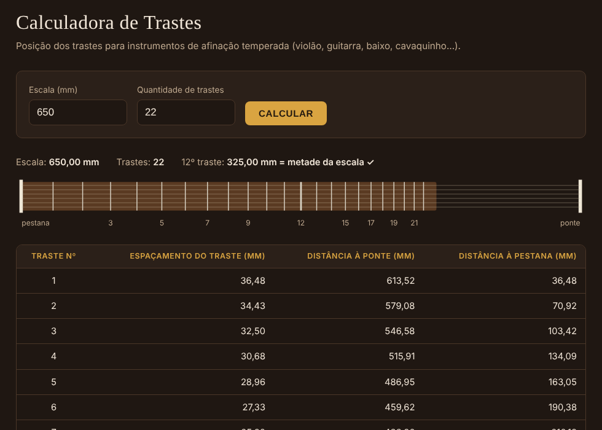

# API Calculadora de Trastes

**Projeto de Extensão — Programação Funcional com a Linguagem Clojure**
Instituto Mauá de Tecnologia · Prof. Dr. Aparecido V. de Freitas

---

## 1. Componentes do grupo

| Nome | RA |
|---|---|
| Leo _(sobrenome)_ | _(RA)_ |
| _(integrante 2)_ | _(RA)_ |
| _(integrante 3)_ | _(RA)_ |

---

## 2. Descrição geral do projeto

Em instrumentos de cordas trasteados (violão, guitarra, baixo, cavaquinho), a posição correta de cada traste é o que garante a afinação ao longo de todo o braço. Essa posição não cresce de forma linear: ela segue uma **progressão exponencial**, porque na afinação temperada a oitava é dividida em 12 semitons iguais.

Este projeto é uma **API REST escrita em Clojure** que recebe a **escala** do instrumento (distância, em milímetros, entre a pestana e a ponte) e devolve, para cada traste:

- o número do traste;
- o tamanho do espaço do traste (mm);
- a distância do traste até a ponte (mm);
- a distância do traste até a pestana (mm).

**Público-alvo:** estudantes de música, músicos profissionais e construtores de instrumentos (luthiers).

**Caráter extensionista:** a API foi pensada para ser integrada ao site do luthier parceiro, José Valderrama. Ela serve como ferramenta prática para os visitantes e divulga o curso de formação em Lutheria e o trabalho artesanal.

### Fórmulas utilizadas

| Grandeza | Fórmula |
|---|---|
| Distância da pestana ao traste _n_ | `d(n) = L × (1 − 1 / 2^(n/12))` |
| Distância do traste _n_ à ponte | `L − d(n)` |
| Tamanho do espaço do traste 1 | `d(1)` |
| Tamanho do espaço do traste _n_ (n > 1) | `d(n) − d(n−1)` |

Onde `L` é a escala em mm e `n` é o número do traste.

**Verificação:** no 12º traste, `d(12) = L / 2`. Para uma escala de 650 mm, isso dá 325 mm da pestana e 325 mm da ponte. A API devolve essa verificação em toda resposta.

---

## 3. Arquitetura do sistema

O código é dividido em camadas. O cálculo fica isolado em **funções puras**, e os efeitos colaterais (rede, console) ficam só nas bordas do sistema.

```
            Navegador (front-end web)              Site do luthier / outro cliente
                       |                                          |
                       |  HTTP GET /api/trastes?escala=650        |
                       v                                          v
   +------------------------------------------------------------------------+
   |  trastes.servidor   Adaptador HTTP (servidor embutido no Java)         |
   |                     converte HttpExchange <-> map Clojure              |
   +------------------------------------------------------------------------+
   |  trastes.http       Rotas e handlers (requisição map -> resposta map)  |
   |                     CORS, cabeçalhos de segurança, códigos HTTP        |
   +-----------------------------+------------------------------------------+
   |  trastes.validacao          |  trastes.json                            |
   |  converte e valida entrada  |  gera o JSON da resposta                 |
   +-----------------------------+------------------------------------------+
   |  trastes.calculo    Funções puras: fórmula, tabela, verificação        |
   +------------------------------------------------------------------------+
```

| Arquivo | Responsabilidade |
|---|---|
| `src/trastes/calculo.clj` | Fórmulas e montagem da tabela de trastes (100% funções puras) |
| `src/trastes/validacao.clj` | Conversão e validação dos parâmetros de entrada |
| `src/trastes/json.clj` | Geração de JSON (sem bibliotecas externas) |
| `src/trastes/http.clj` | Tabela de rotas e handlers no modelo do Ring (map → map) |
| `src/trastes/servidor.clj` | Liga a aplicação ao servidor HTTP do Java |
| `src/trastes/main.clj` | Ponto de entrada (`-main`) |
| `resources/public/index.html` | Front-end web que consome a API |
| `test/trastes/*_test.clj` | Testes automatizados (`clojure.test`) |

**Decisão de projeto: nenhuma dependência externa.** O servidor HTTP é o `com.sun.net.httpserver`, que já vem no Java, e o JSON é gerado por uma função própria. Na prática, isso traz três vantagens:

- o projeto roda em qualquer computador que tenha Java e Clojure, sem baixar bibliotecas;
- a superfície de ataque é menor, porque não há dependências de terceiros para manter atualizadas;
- todo o código pode ser lido e explicado pelo grupo.

Os handlers seguem o mesmo contrato do **Ring**, o padrão de APIs web em Clojure: requisição e resposta são maps. Por isso, migrar para Ring + Jetty no futuro exige mudar apenas o adaptador.

---

## 4. Fluxo operacional

1. O usuário informa a escala, e opcionalmente a quantidade de trastes, no front-end e clica em **Calcular**.
2. O navegador faz `GET /api/trastes?escala=650&trastes=22`.
3. `trastes.servidor` converte a requisição Java em um map Clojure e chama `trastes.http/app`.
4. `app` consulta a tabela de rotas e chama `handler-trastes`.
5. `trastes.validacao` converte os textos em números e confere os limites:
   - se a entrada for inválida, a API responde **HTTP 400** com a lista de erros;
   - se for válida, segue para o cálculo.
6. `trastes.calculo/calcular` gera, com `mapv` sobre `(range 1 (inc n))`, um map por traste, mais a verificação do 12º traste.
7. `trastes.json` converte o resultado em JSON, e a resposta volta com **HTTP 200**.
8. O front-end monta a tabela e o desenho do braço em escala, e oferece o download em CSV.

---

## 5. Funcionalidades principais

- Cálculo da distância de cada traste à pestana e à ponte, e do tamanho de cada espaço.
- Quantidade de trastes configurável, de 1 a 36 (padrão: 22, como na planilha de referência).
- Verificação automática do 12º traste, que deve ficar na metade da escala.
- Validação de entrada com mensagens claras:
  - aceita decimal com ponto ou vírgula (`648.5` ou `648,5`);
  - rejeita texto, valores fora da faixa (100 a 1200 mm), `NaN`/`Infinity` e parâmetros longos demais.
- Respostas e códigos HTTP corretos: 200, 400, 404, 405 e 500 sem expor detalhes internos.
- CORS habilitado, para que o site do luthier possa chamar a API diretamente.
- Cabeçalhos de segurança: `X-Content-Type-Options`, `Content-Security-Policy` na página e `Referrer-Policy`.
- Front-end web responsivo:
  - tabela de resultados com o 12º traste destacado;
  - desenho do braço em escala;
  - exportação em CSV, que abre direto no Excel.
- 13 testes automatizados com 59 verificações, incluindo os valores da planilha do luthier (escala 655 mm) e do exemplo da especificação (650 mm).



---

## 6. Tecnologias utilizadas

| Tecnologia | Uso |
|---|---|
| **Clojure 1.12** | Linguagem de todo o back-end |
| Clojure CLI (`deps.edn`) | Gerenciamento do projeto e execução (`clj -M:run`, `clj -M:test`) |
| `clojure.test` | Testes automatizados |
| `com.sun.net.httpserver` (JDK) | Servidor HTTP embutido no Java |
| Java 21 (Temurin) | Plataforma de execução (funciona a partir do Java 11) |
| HTML + CSS + JavaScript | Front-end web (sem frameworks) |

Conceitos de programação funcional aplicados:

- funções puras;
- dados imutáveis (maps e vectors);
- funções de ordem superior (`mapv`, `keep`, `every?`);
- `let`, `cond` e `if-let`;
- dados como interface (rotas definidas como um map);
- separação entre lógica pura e efeitos colaterais.

---

## 7. Infraestrutura de execução do projeto

- **Execução local:** um único processo Java, que serve a API e o front-end na mesma porta (padrão `3000`).
- **Requisitos de hardware:** mínimos. Qualquer computador do laboratório ou notebook pessoal atende.
- **Variáveis de ambiente (opcionais):**

| Variável | Padrão | Descrição |
|---|---|---|
| `PORT` | `3000` | Porta HTTP |
| `CORS_ORIGIN` | `*` | Origem autorizada a chamar a API (ex.: `https://site-do-luthier.com.br`) |

- **Produção (proposta):** o mesmo processo pode rodar em qualquer serviço que execute Java, como uma VM na nuvem, um contêiner Docker ou Render/Railway/Fly.io, atrás de um proxy HTTPS. O site do luthier chamaria a API pelo endereço público, com `CORS_ORIGIN` restrito ao domínio dele.

---

## 8. Configuração do ambiente para instalação

### Windows

1. **Java:**
   - instale o Temurin 21 (LTS) em <https://adoptium.net/>, deixando marcada a opção que coloca o Java no PATH;
   - para conferir, rode `java --version`.
2. **Clojure:**
   - instale o `clj-msi` em <https://github.com/casselc/clj-msi>, na seção Releases;
   - feche e abra o terminal de novo;
   - para conferir, rode `clj --version`.
3. **Projeto:** extraia o `.zip` e, no terminal, entre na pasta `trastes-api`.

### Linux / macOS

- Java: `sudo apt install openjdk-21-jdk` ou `brew install openjdk@21`.
- Clojure: siga <https://clojure.org/guides/install_clojure>. No macOS: `brew install clojure/tools/clojure`.

### Executando

```bash
# Subir a API (na primeira vez o Clojure é baixado automaticamente)
clj -M:run

# Rodar os testes automatizados
clj -M:test
```

Com a API no ar:

- Front-end: <http://localhost:3000/>
- API: <http://localhost:3000/api/trastes?escala=650>

Para encerrar, use `Ctrl+C`.

Para usar outra porta no Windows PowerShell: `$env:PORT=8080; clj -M:run`.

---

## 9. Endpoints – API

### `GET /api/trastes`

Calcula a posição dos trastes.

| Parâmetro | Obrigatório | Tipo | Faixa | Descrição |
|---|---|---|---|---|
| `escala` | sim | número (mm) | 100 a 1200 | Distância pestana → ponte. Aceita `648.5` ou `648,5` |
| `trastes` | não | inteiro | 1 a 36 | Quantidade de trastes (padrão: 22) |

**Exemplo:**

```
GET /api/trastes?escala=650&trastes=3
```

**Resposta 200:**

```json
{
  "escala_mm": 650.0,
  "quantidade_trastes": 3,
  "formula": "d_n = L * (1 - 1 / 2^(n/12))",
  "verificacao": {
    "traste_12_distancia_pestana_mm": 325.0,
    "metade_da_escala_mm": 325.0,
    "confere": true
  },
  "trastes": [
    {"traste": 1, "tamanho_espaco_mm": 36.48, "distancia_ponte_mm": 613.52, "distancia_pestana_mm": 36.48},
    {"traste": 2, "tamanho_espaco_mm": 34.43, "distancia_ponte_mm": 579.08, "distancia_pestana_mm": 70.92},
    {"traste": 3, "tamanho_espaco_mm": 32.5,  "distancia_ponte_mm": 546.58, "distancia_pestana_mm": 103.42}
  ]
}
```

**Resposta 400 (entrada inválida):**

```
GET /api/trastes?escala=abc&trastes=99
```

```json
{
  "erro": "Parâmetros inválidos",
  "detalhes": [
    "Parâmetro 'escala' inválido: 'abc'. Informe um número, por exemplo 650 ou 648.5",
    "A quantidade de trastes deve estar entre 1 e 36."
  ]
}
```

### `GET /api/saude`

Verifica se a API está no ar.

```json
{"status": "ok", "servico": "api-trastes", "versao": "1.0.0"}
```

### `GET /`

Front-end web da calculadora.

### Códigos de resposta

| Código | Quando |
|---|---|
| 200 | Cálculo realizado |
| 204 | Pré-verificação CORS (`OPTIONS`) |
| 400 | Parâmetros ausentes ou inválidos |
| 404 | Rota inexistente |
| 405 | Método diferente de `GET` em uma rota existente |
| 500 | Erro interno (detalhes ficam só no log do servidor) |

---

## 10. Futuras melhorias (Roadmap)

- **Banco de dados:** guardar o histórico de cálculos e as escalas mais usadas (ex.: SQLite via `next.jdbc`), para estatísticas de uso no site do luthier.
- **Escalas múltiplas (multiescala / fanned frets):** calcular a posição dos trastes com escalas diferentes para graves e agudos.
- **Unidades:** aceitar e devolver valores em polegadas.
- **Compensação de ponte:** sugerir o recuo do rastilho por corda.
- **Exportação:** gerar um gabarito em PDF/SVG em escala 1:1 para impressão e uso direto na marcação do braço.
- **Front-end mobile** (Android) consumindo a mesma API.
- **Publicação:** deploy em nuvem com HTTPS e integração na página "Cálculo de Trastes" do site do luthier.
- **Migração para Ring + Reitit + Jetty**, caso a API cresça (os handlers já seguem o contrato do Ring).
- **Limite de requisições por IP** (rate limiting) quando estiver exposta na internet.

---

## 11. Referências

- FREITAS, A. V. _Programação Funcional com a Linguagem Clojure — Especificação do Projeto de Extensão_. Instituto Mauá de Tecnologia, 2026.
- Clojure — Getting Started / Install Clojure. <https://clojure.org/guides/install_clojure>
- Clojure — Deps and CLI Guide. <https://clojure.org/guides/deps_and_cli>
- Clojure — `clojure.test` API. <https://clojure.github.io/clojure/clojure.test-api.html>
- Oracle — Java SE 21, `com.sun.net.httpserver.HttpServer`. <https://docs.oracle.com/en/java/javase/21/docs/api/jdk.httpserver/com/sun/net/httpserver/HttpServer.html>
- Ring — Especificação do contrato requisição/resposta. <https://github.com/ring-clojure/ring/blob/master/SPEC.md>
- Wikipedia — Temperamento igual. <https://pt.wikipedia.org/wiki/Temperamento_igual>
- MDN — Cross-Origin Resource Sharing (CORS). <https://developer.mozilla.org/pt-BR/docs/Web/HTTP/CORS>
